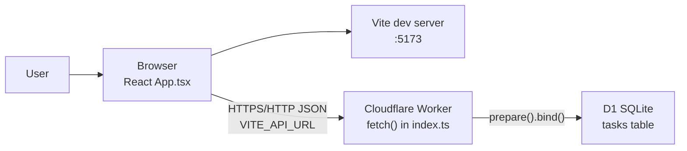
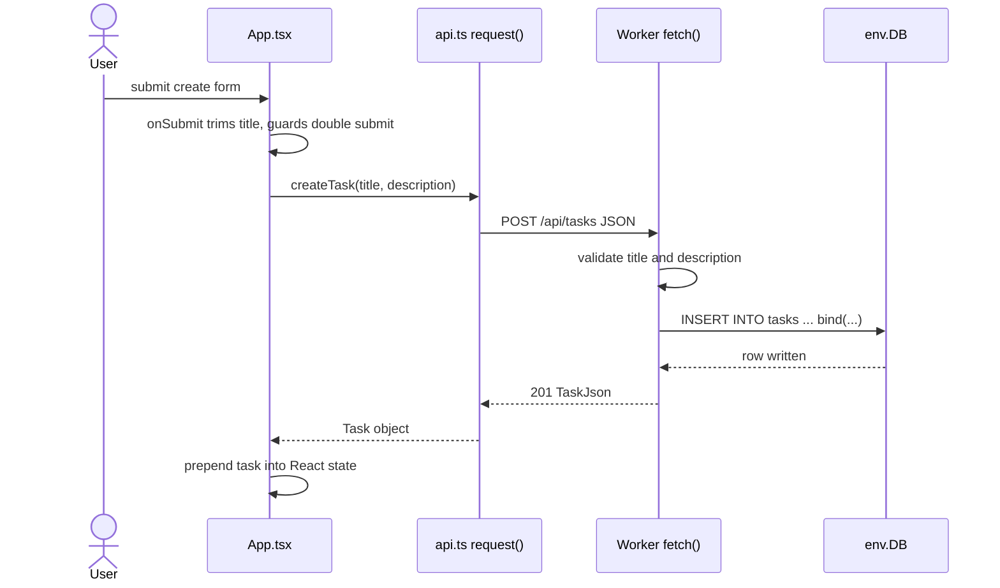
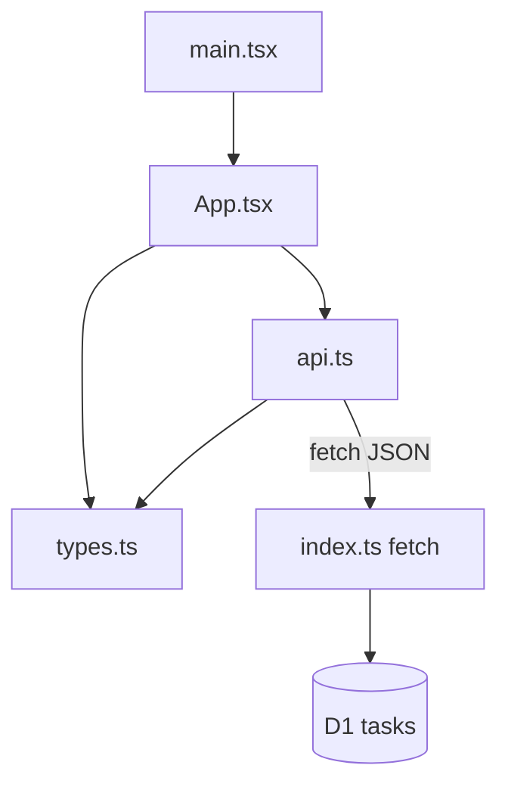

# System Architecture Design Document

**Project:** Task Manager  
**Document type:** Architecture design (as implemented)  
**Scope:** React + Vite frontend, Cloudflare Worker REST API, Cloudflare D1  
**Sources:** `web/`, `worker/`, `requirements.md`, `README.md`

This document describes the system that is present in the repository. Proposed changes are labelled as such and are not implemented.

## 1. Overall system architecture

The application is a three-tier, request–response system with a thin client, a single HTTP Worker, and one relational store. The browser never talks to D1. The Worker never renders HTML. There is no authentication service, message queue, cache, or object store in the current code.

| Layer | Role | Implementation |
| --- | --- | --- |
| Presentation | Single-page UI | React 19 in `web/`, served by Vite 8 in development |
| Application / API | REST over HTTP | Cloudflare Worker `task-manager-api`, entry `worker/src/index.ts` |
| Persistence | Durable task rows | Cloudflare D1 database `task_manager_db`, binding `DB` |
| Platform | Runtime and local tooling | Cloudflare Workers / Wrangler 4; local D1 under `worker/.wrangler/` |

The only cross-origin coupling in local development is the Vite origin `http://localhost:5173` calling the Worker at `http://127.0.0.1:8787`. The client base URL is `import.meta.env.VITE_API_URL` with a fallback of `http://127.0.0.1:8787` (`web/src/api.ts`). CORS on the Worker is a fixed allowlist of that Vite origin (`CORS_HEADERS` in `worker/src/index.ts`).

`wrangler.jsonc` does not bind static assets. The frontend and API are separate processes. Production hosting of `web/dist/` is documented in the README and is not configured in Wrangler.



### Request path (create task)

A typical write shows every hop that exists today.



On load, `useEffect` in `App` calls `listTasks()` → `GET /api/tasks` → `SELECT ... ORDER BY created_at DESC`. Toggle and delete follow the same pattern with `PATCH` and `DELETE`. Failed mutations keep the previous list in memory and set `error` (`App.tsx`). D1 remains the source of truth after a full page reload.

## 2. Module design

The codebase is small. Logical modules match directories and files rather than a framework of services.

### 2.1 Presentation module (`web/src/`)

**Purpose.** Render one page that lists tasks and accepts create, toggle, and delete actions (FR-01 through FR-04, NFR-01).

**Responsibilities.**

- Bootstrap the React tree (`main.tsx` mounts `App` into `#root`).
- Hold UI state: `tasks`, form fields, `loading`, `submitting`, `error`, `busyIds`.
- Call the API client and update local state after success.
- Apply presentation rules: empty copy, loading copy, `role="alert"` errors, completed styling, `maxLength` on inputs.

**Key functions.** `App` (default export), `refresh`, `onSubmit`, `onToggle`, `onDelete` in `web/src/App.tsx`.

**Dependencies.** React hooks; `listTasks`, `createTask`, `setTaskCompleted`, `deleteTask` from `./api`; `Task` from `./types`; `App.css`.

This module does not open D1 and does not encode SQL.

### 2.2 API client module (`web/src/api.ts`, `web/src/types.ts`)

**Purpose.** Isolate HTTP from the UI (NFR-03).

**Responsibilities.** Compose URLs, send JSON, treat HTTP 204 as an empty success, parse `{ error: string }` on failure, throw `Error` so `App` can display a message.

**Key functions.**

```ts
async function request<T>(path: string, init?: RequestInit): Promise<T>
export function listTasks(): Promise<Task[]>
export function createTask(title: string, description: string): Promise<Task>
export function setTaskCompleted(id: string, completed: boolean): Promise<Task>
export function deleteTask(id: string): Promise<void>
```

`Task` in `types.ts` matches the Worker’s JSON resource (`id`, `title`, `description`, `completed`, `createdAt`).

**Dependencies.** Browser `fetch`; Vite env `VITE_API_URL`.

### 2.3 HTTP API module (`worker/src/index.ts`)

**Purpose.** Expose the REST contract in FR-05 and map rows to JSON.

**Responsibilities.** Route on `method` and `pathname` inside a single `fetch` handler. Validate POST and PATCH bodies. Apply CORS. Convert D1 rows with `rowToTask`. Return `{ error }` JSON for 400 and 404.

**Key types and helpers.** `Env` (`DB: D1Database`), `TaskRow`, `TaskJson`, `json`, `empty`, `rowToTask`, `notFound`, default export `fetch(request, env)`.

**Dependencies.** Workers runtime (`Request`, `Response`, `crypto.randomUUID`); `env.DB`. There is no router library, ORM, or extra Worker file.

A `GET /` handler reports `{ ok, service: "task-manager-api", tasksTableReady }`. It is a local health helper, not a task resource.

### 2.4 Persistence module (D1)

**Purpose.** Store one shared `tasks` table (NFR-02).

**Schema** (`worker/migrations/0001_create_tasks.sql`):

| Column | SQLite type | Notes |
| --- | --- | --- |
| `id` | TEXT PRIMARY KEY | UUID generated in the Worker |
| `title` | TEXT NOT NULL | Trimmed, 1–200 characters at the API |
| `description` | TEXT | Null when the client sends an empty string |
| `completed` | INTEGER NOT NULL DEFAULT 0 | `0` or `1`; JSON uses boolean |
| `created_at` | TEXT NOT NULL | ISO-8601 UTC set on insert |

**Binding.** `worker/wrangler.jsonc`: binding `DB`, database name `task_manager_db`, `migrations_dir` `migrations`. The checked-in `database_id` is the local placeholder `00000000-0000-0000-0000-000000000001`.

**Dependencies.** Wrangler scripts `db:migrate:local` and `db:migrate:remote`. Queries use `prepare().bind()` only.

### 2.5 Module dependencies



`.agents/`, `skills-lock.json`, and course docs are not runtime modules.

## 3. Interface design

Communication is JSON over HTTP. The UI uses `Content-Type: application/json` on every `request()` call. Path IDs are `encodeURIComponent`’d in `setTaskCompleted` and `deleteTask`. CORS preflight is `OPTIONS` on paths that start with `/api/`, returning 204.

### 3.1 REST endpoints (implemented)

| Method | Path | Success | Body | Failure |
| --- | --- | --- | --- | --- |
| `GET` | `/api/tasks` | `200` `TaskJson[]`, newest first | none | |
| `POST` | `/api/tasks` | `201` `TaskJson` | `{ title, description? }` | `400` invalid JSON, empty title, title > 200, description > 2000 |
| `PATCH` | `/api/tasks/:id` | `200` `TaskJson` | `{ completed: boolean }` | `400` if `completed` is not boolean; `404` unknown id |
| `DELETE` | `/api/tasks/:id` | `204` empty body | none | `404` unknown id |
| `OPTIONS` | `/api/*` | `204` | none | |
| `GET` | `/` | `200` health JSON | none | |

Unknown `/api/*` routes return `404` `{ "error": "Not found" }`. PATCH updates only `completed`. There is no PUT, no title update, and no query-string filter.

### 3.2 Resource and error shapes

Worker JSON (`TaskJson`):

```ts
type TaskJson = {
  id: string;
  title: string;
  description: string; // "" when the row is null
  completed: boolean;
  createdAt: string;
};
```

Frontend type `Task` uses the same fields. Errors are `{ "error": "human-readable message" }` with status 400 or 404. The Worker does not implement a dedicated 500 handler; uncaught runtime errors would surface as the platform default, not as this JSON shape.

### 3.3 Worker environment

```ts
export interface Env {
  DB: D1Database;
}
```

`fetch` is `async fetch(request: Request, env: Env): Promise<Response>`.

## 4. Design rationale

**Why this split.** The assignment (NFR-05, NFR-06) requires React + Vite, a Cloudflare Worker, and D1, with the UI and API runnable as two processes. Sibling packages `web/` and `worker/` satisfy NFR-03 without a monorepo root. A single `fetch` function is enough for four routes; a router or service layer would add files without changing behaviour.

**Separation of concerns.** UI state lives in React. HTTP mapping lives in `api.ts`. Validation and SQL live in the Worker. The UI also trims titles and sets `maxLength`, but the Worker repeats those rules so a raw `curl` cannot skip them (NFR-04). Parameterized SQL avoids string-concatenated queries.

**Maintainability.** TypeScript on both sides, a shared JSON field set, and a one-file API keep the prototype readable for a course marker. The cost is that routing, CORS, validation, and SQL share `index.ts`. That is a deliberate small-system choice, not a claim of hexagonal architecture.

**Scalability.** Workers scale with Cloudflare’s request model. D1 is a single shared SQLite database. The list endpoint loads every row. That matches NFR-style course load (under 100 tasks) and does not claim horizontal data partitioning. Pagination is out of scope.

**Reliability.** Persistence is D1, not `localStorage`. `submitting` and `busyIds` reduce double submits. Failed mutations do not clear the list. There are no retries, no transactions across multiple statements on PATCH (update then select), and no automated Worker test suite in `package.json`.

**Security (honest).** There is no authentication. One deployment is one global list (`requirements.md` §3). CORS allows only `http://localhost:5173`. That is correct for local Vite and insufficient for a production frontend origin until the allowlist is changed (documented, not implemented). UUID ids are unguessable in practice but not an access-control model. Production `database_id` is still a placeholder until a real D1 database is created.

**Fit to requirements.** FR-01–FR-05 map one-to-one onto `App` + `fetch` routes. NFR-02 is the D1 table. NFR-05’s documented Cloudflare path is in `README.md`; a verified production URL is not part of this architecture.

### Implemented versus proposed

| Topic | Implemented | Proposed (not in code) |
| --- | --- | --- |
| CORS | Local Vite origin only | Add the production UI origin |
| Auth | None | Per-user lists if the product expands |
| Frontend host | Separate Vite / static `dist/` | Workers static assets or Pages, if chosen later |
| Remote D1 id | Placeholder UUID | Real id from `wrangler d1 create` |
| API tests | Manual curl / README | Optional Vitest; not present |

These proposals are future work. They are not current modules.

## References

- `web/src/App.tsx`, `web/src/api.ts`, `web/src/types.ts`, `web/src/main.tsx`
- `worker/src/index.ts`, `worker/wrangler.jsonc`, `worker/migrations/0001_create_tasks.sql`
- `requirements.md`, `README.md`
